# Create a game

Make a new game on a blank disk: a SASI hard disk a game installs to, or a floppy a game keeps its saves on. Kairo68 makes the blank disk; the X68000 prepares it with Human68k, as on the real machine. Your system and game disks can stay wherever they are (for example in Download): the Disks page takes them from anywhere on the device.

This example installs a floppy game onto a new 20 MB hard disk with Human68k 3.02.

## 1. Create the blank disk

Open the library menu › **Manage library**. Under **New game**, choose the disk: a 1.2 MB 2HD floppy, or a 10, 20 or 40 MB SASI hard disk.

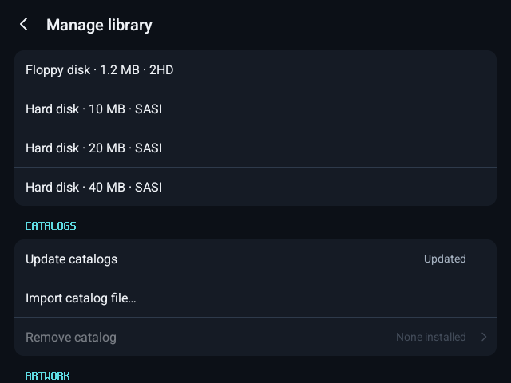

Name the game and press **Create**. Kairo68 makes a folder of that name in your games folder with the blank disk in it.

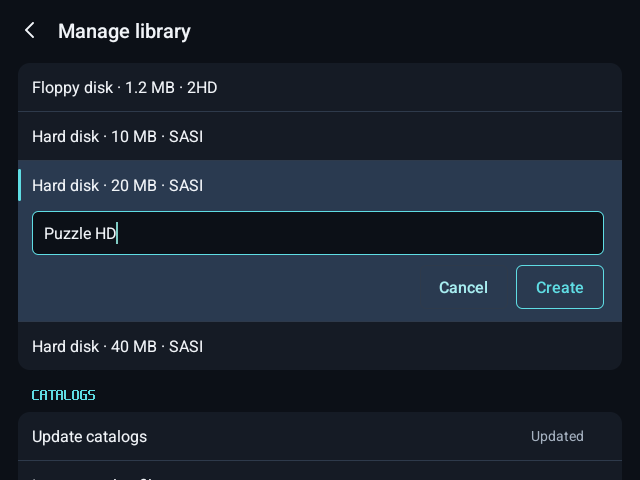

The new game is in the library, as a hard disk.

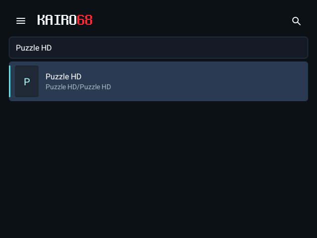

## 2. Put in the system disk

Press **Play**. With only a blank hard disk, the X68000 asks for a disk to start from.

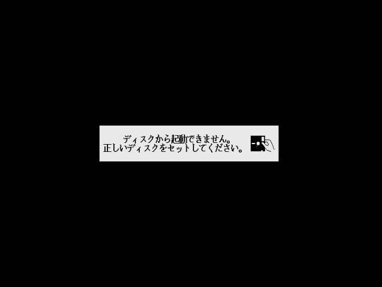

Open the menu › **Disks** › **Floppy 0** › **Choose file…** and pick your Human68k system disk from wherever it is.

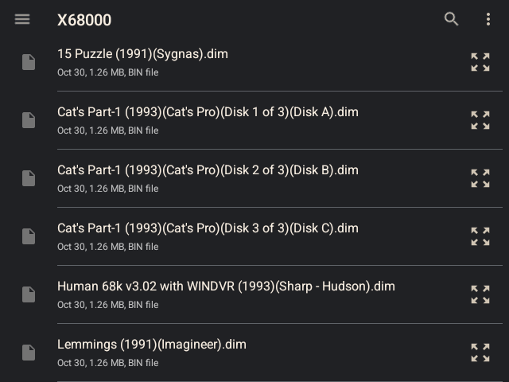

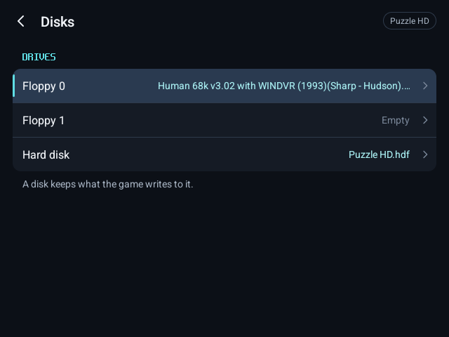

The X68000 starts Human68k from it.

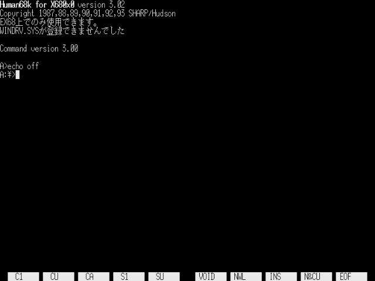

## 3. Prepare the hard disk

Run `sys\float2` (FORMAT.X needs the float package), then `bin\format`, and choose **ハードディスク** (hard disk).

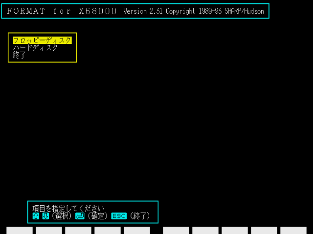

Choose **装置初期化** (initialize) and the drive's capacity, then **Y**.

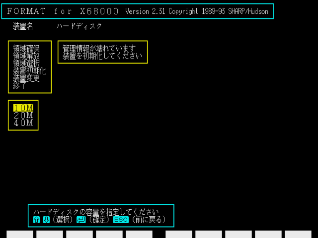

Choose **領域確保** (allocate), enter the capacity, keep **システム転送** (system transfer) on **する**, and run it with **実行** and **Y**.

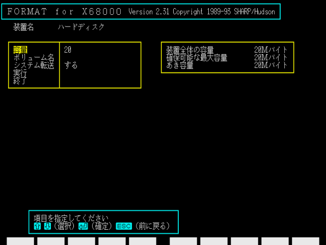

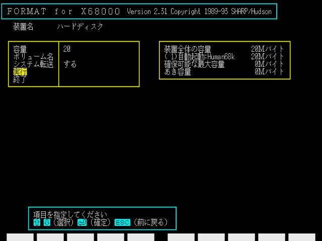

Answer **Y** to restart. Human68k gives the hard disk the letter after the floppy units: `dir e:` shows the new drive.

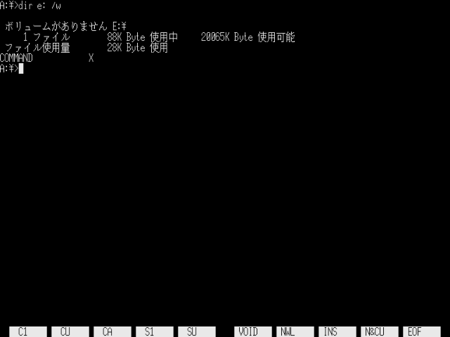

## 4. Install the game

Put the game's disk in **Floppy 1** the same way (Disks › Floppy 1 › Choose file…).

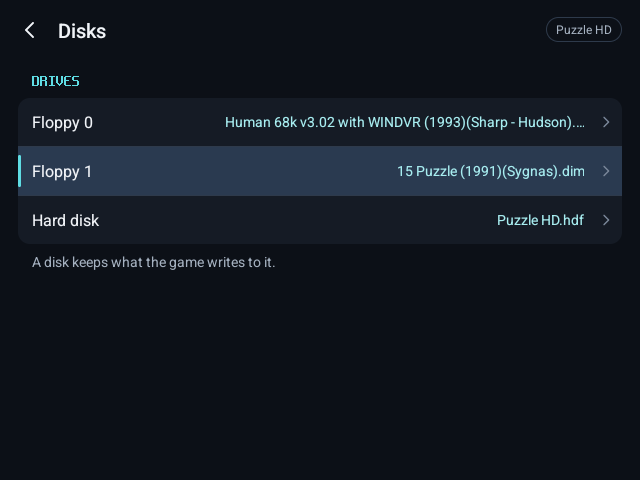

Copy it to the hard disk, or run the game's own installer. Here: `bin\copyall b:\*.* e:\`.

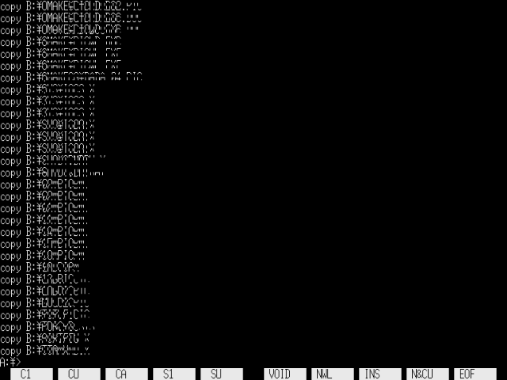

On a hardware keyboard, the X68000's JIS layout puts `:` and `*` where a US keyboard has other symbols; the on-screen keyboard's **?123** page has both.

## 5. Play from the hard disk

Take the floppies out (Disks › Floppy 0 and Floppy 1 › **Empty**). From now on the game is in your library under the name you gave it, and **Play** starts it from its hard disk.

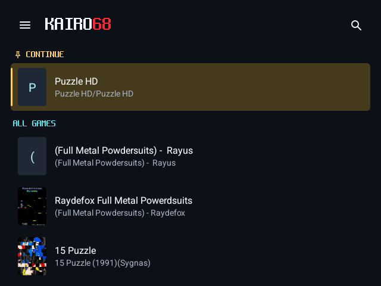

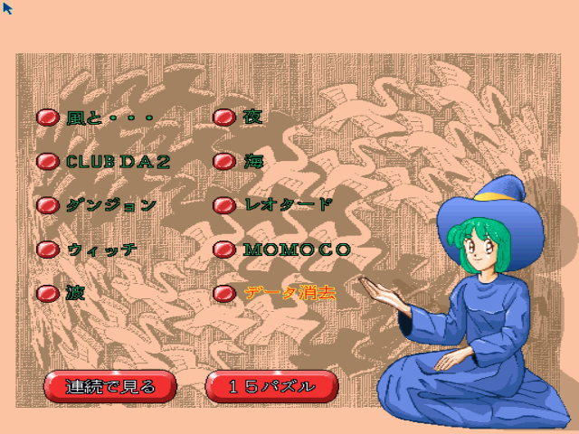

Everything written to the disk stays on it between sessions. Restart game keeps whatever disks are in the drives, as a reset does on the real machine.
